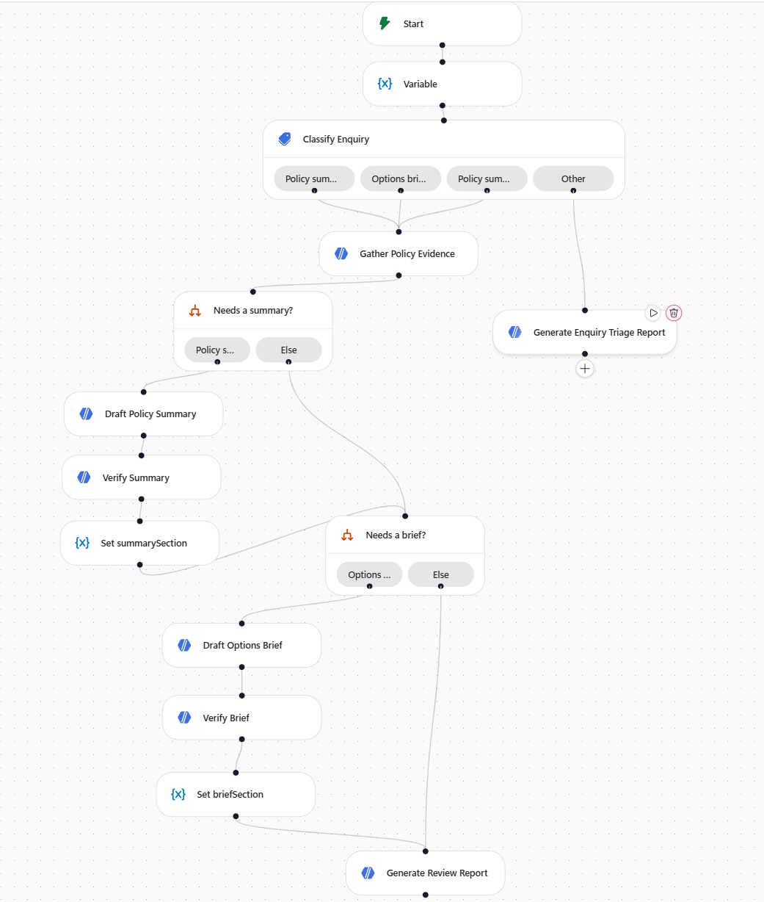
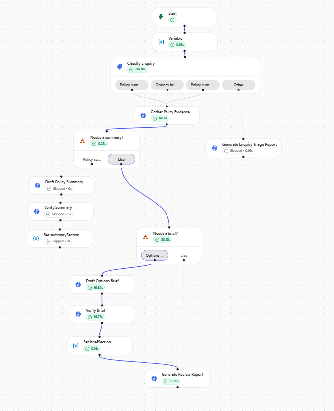
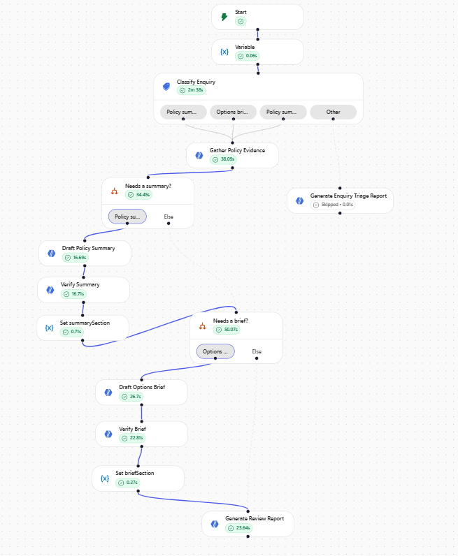
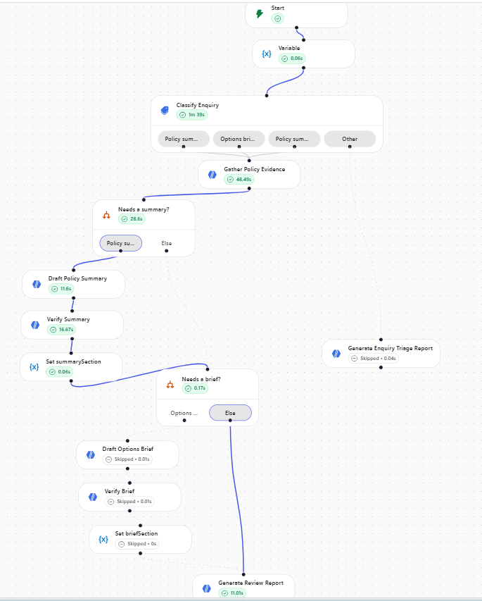

# ACT AI Policy Enquiry Workflow

This Copilot Studio workflow takes a staff enquiry and produces a cited policy summary, an options brief, or both. It presents drafts and verification notes in **Activity** for human review after the run.

## Workflow canvas

## How a run works

1. **Start** accepts the enquiry as text. **Variable** initialises `summarySection` and `briefSection` as empty strings.
2. **Classify Enquiry** selects the requested deliverable. **Other** goes directly to **Generate Enquiry Triage Report**, which asks a focused clarification question or explains why the enquiry falls outside scope.
3. The three policy categories converge at **Gather Policy Evidence**. This agent reads PDFs stored in SharePoint through its configured knowledge sources, including the *ACT Government Artificial Intelligence Policy* and the *Acceptable Use of ICT Resources Policy*. It passes cited findings and any material gaps to the drafting and verification agents in the shared `researchFindings` field.
4. **Needs a summary?** runs **Draft Policy Summary → Verify Summary → Set summarySection** for summary-only and combined requests. Both exits lead to **Needs a brief?**
5. **Needs a brief?** runs **Draft Options Brief → Verify Brief → Set briefSection** for brief-only and combined requests. Both exits lead to **Generate Review Report**.
6. **Generate Review Report** uses the original enquiry, selected category and the two variables to present only the requested draft sections.

| Category | Steps after classification | Report |
|---|---|---|
| Policy summary only | Research, draft and verify the summary | Summary with verification status and notes |
| Options brief only | Research, draft and verify the brief | Brief with verification status and notes |
| Policy summary and options brief | Research once, then draft and verify the summary followed by the brief | Both drafts, each with its own status and notes |
| Other | Triage | Clarification needed or Outside workflow scope |

## Data passed between nodes

| Field | Producer | Used by |
|---|---|---|
| `Enquiry` | Start | Classifier, research, drafting, verification and reports |
| `Category` | Classify Enquiry | Both If/Else checks and the policy report |
| `researchFindings` | Gather Policy Evidence | Both drafting and verification agents |
| `policySummary` and `optionsBrief` | Respective drafting agents | Respective verifier and section assignment |
| `policySummaryStatus`, `policySummaryReview`, `optionsBriefStatus`, `optionsBriefReview` | Respective verification agents | Respective section assignment |
| `summarySection` and `briefSection` | Variable actions after verification | Generate Review Report |

Each section variable stores the draft, its verification status and its notes. If a drafting step is skipped, its variable stays empty. The report reads the initialised variables so it can run without outputs from skipped nodes.

## Testing and review

- Both conditional checks must include **Policy summary and options brief** as an OR match. The combined retest returned both drafts after this was corrected.
- Keep **Other** on its separate triage path. A previous run skipped the shared report when triage joined the same endpoint. A summary-only run reached the shared policy report after the paths were separated.
- In **Activity**, check that research ran once for a policy enquiry, each requested draft and verifier ran, and the report preserves the draft wording, citations, status and notes.
- A workflow run can succeed while a draft is marked **Needs revision**. The reviewer checks material claims against the PDFs after the run and decides what goes into the final brief.
- Check the remaining issues in the checklist. The brief-only verifier reported empty research findings, and some copied reports contained two versions.

## Evidence from workflow runs

**Options brief only.** The run skipped the summary steps, drafted and verified the brief, set `briefSection` and completed **Generate Review Report**.

**Policy summary and options brief.** The run gathered evidence once, drafted and verified the summary, then drafted and verified the brief. Both section variables were set before the report ran.

**Screenshot labelled summary only.** The activity trace shows that **Draft Options Brief**, **Verify Brief** and **Set briefSection** also completed. A screenshot confirming the summary-only route would show those three steps as skipped and **Generate Review Report** as completed.

## Related records

- [Workflow prompts](docs/WORKFLOW-PROMPTS.md) includes the prompts and token mappings used during development. Use this document for the current canvas layout.
- [Workflow test reports](docs/WORKFLOW-TEST-REPORTS.md) pairs the enquiries with recorded results.
- [Build and review checklist](CHECKLIST.md) tracks completed work and open checks.
